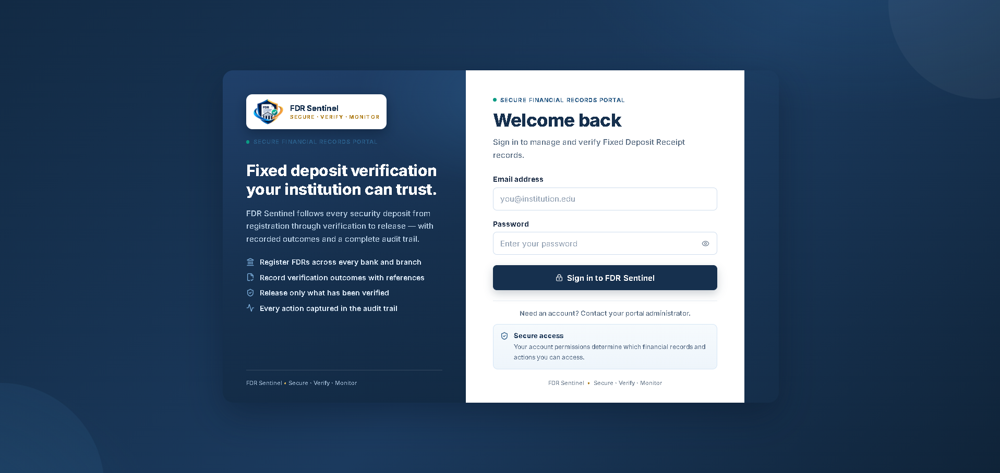
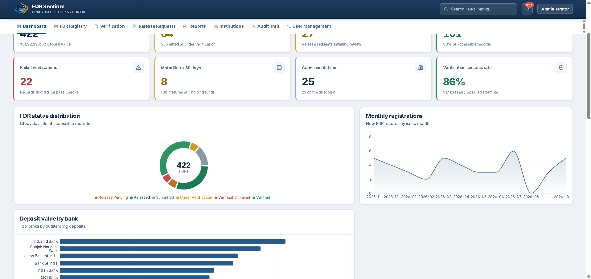
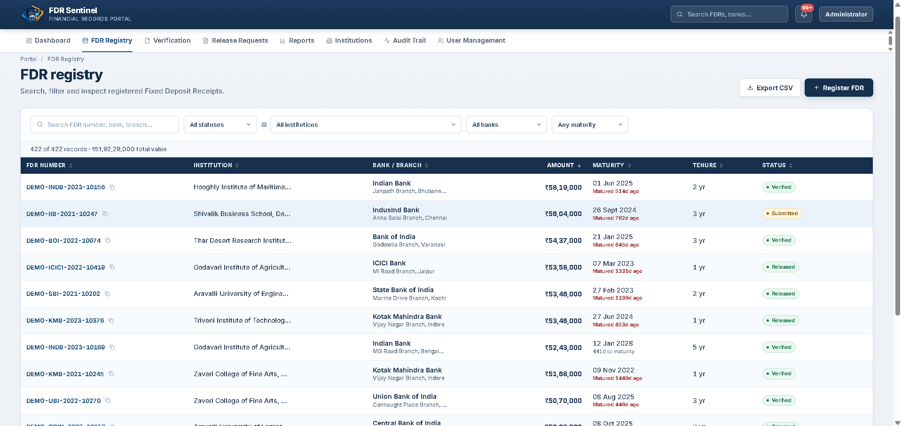
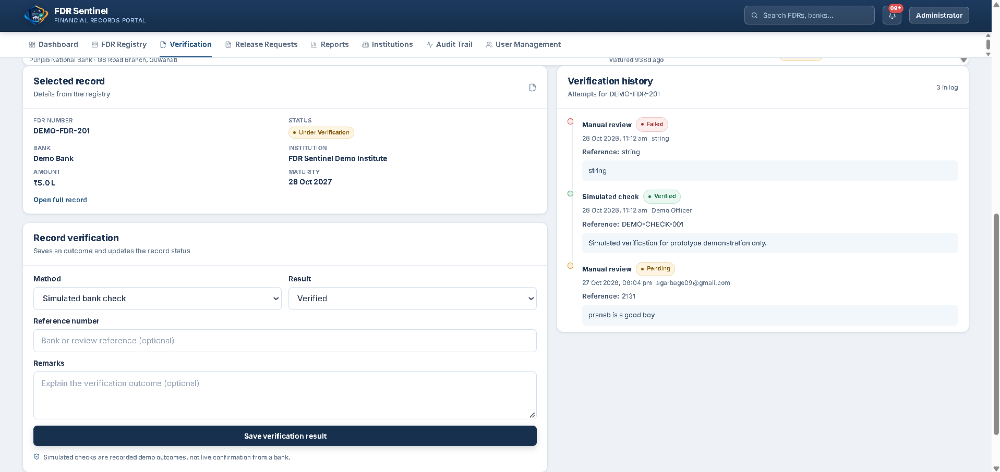
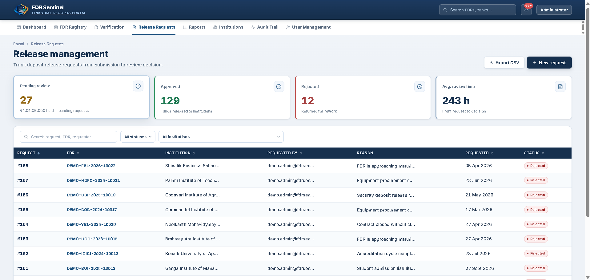
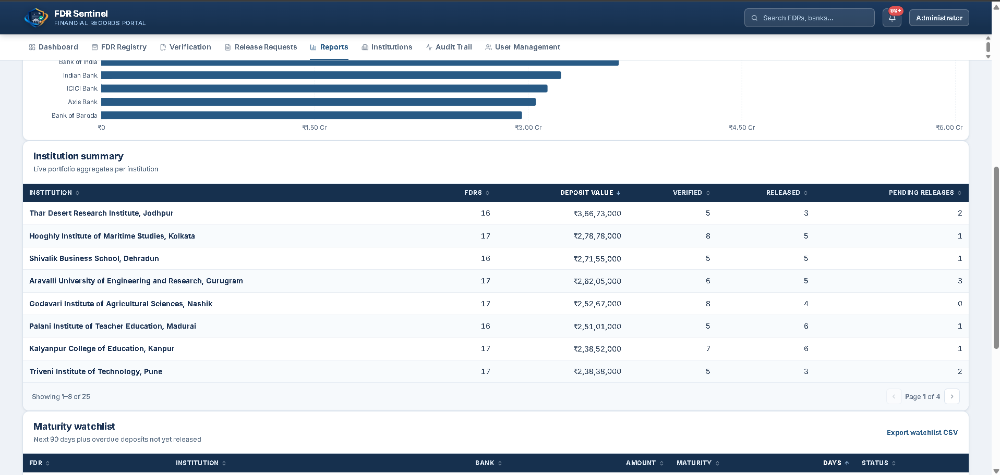
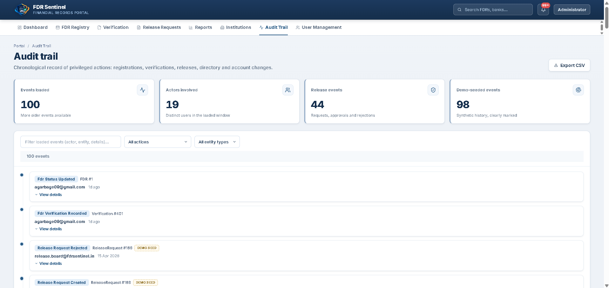

 <div align="center">

# 🛡️ FDR SENTINEL

### Digital Security Deposit & Fixed Deposit Receipt Management Portal

**From registration to verification to release — one auditable workflow.**

A web-based financial records management prototype that helps institutions register, review, verify, and track Fixed Deposit Receipts (FDRs) and security deposit release requests through a centralized operational portal.

[Platform Overview](#overview) · [Key Features](#key-features) · [Architecture](#architecture) · [Run Locally](#installation) · [Screenshots](#platform-screenshots)

</div>

---

## Why FDR Sentinel?

Security deposit and Fixed Deposit Receipt records need reliable tracking, structured verification, controlled release workflows, and clear accountability. When these activities are spread across disconnected records and manual processes, reviewing status and reconstructing previous actions can become difficult.

FDR Sentinel brings the main workflow into one interface, with institution-aware access, a searchable FDR registry, verification history, release-request management, reports, and audit records.

The goal is to make the workflow **organized, traceable, and easier to review**.

> **Project status:** Prototype / active development. Demo verification outcomes are not live confirmation from a bank.

## Contents

- [Overview](#overview)
- [Key Features](#key-features)
- [FDR Lifecycle](#fdr-lifecycle)
- [Architecture](#architecture)
- [Technology Stack](#technology-stack)
- [Project Structure](#project-structure)
- [Installation](#installation)
- [API Documentation](#api-documentation)
- [Platform Screenshots](#platform-screenshots)
- [Implementation Status and Limitations](#implementation-status-and-limitations)
- [Security](#security)
- [Roadmap](#roadmap)
- [Author](#author)

## Overview

FDR Sentinel is built around the lifecycle of a financial deposit record. It provides administrators and institutional users with a centralized way to work with FDR data and associated verification and release activities.

### Key Capabilities

- Authentication and role-based access
- Institution management
- FDR registration and registry browsing
- Search, filters, and record inspection
- Verification outcomes and verification history
- Release-request submission and review
- Audit trail for operational events
- Reports and CSV exports
- Dashboard metrics and charts
- Shared React components and typed API integration

## Key Features

### FDR Registry

Maintain FDR records containing information such as institution, bank, branch, deposit amount, issue date, maturity date, and status.

### Verification Workflow

Record verification attempts, methods, outcomes, references, remarks, and history. Demo verification actions are clearly distinguished from actual external bank verification.

### Release Requests

Submit and review release requests with recorded decisions and remarks. Release eligibility should be enforced by backend workflow rules.

### Institution and User Management

Organize institution records and manage access through the application's configured roles and authorization rules.

### Audit Trail

Review recorded operational events, including relevant registration, verification, release, and administrative actions.

### Reports and Exports

Use reporting views to inspect available records and export supported datasets to CSV for further analysis.

### Dashboard and Analytics

View high-level metrics, FDR status distribution, monthly registration trends, and deposit values by bank.

## FDR Lifecycle

```text
FDR Registration
       |
       v
Record Submitted
       |
       v
Verification Workflow
       |
       +------------------+
       |                  |
       v                  v
   Verified        Verification Failed
       |
       v
Eligible Release Request
       |
       v
Administrative Review
       |
       +------------------+
       |                  |
       v                  v
    Approved           Rejected
```

The diagram illustrates the intended high-level workflow. Actual state transitions and release eligibility depend on the backend implementation and its validation rules.

## Architecture

```text
+--------------------------------------+
|             React Frontend           |
|                                      |
| Dashboard | Registry | Verification  |
| Releases  | Reports  | Audit Trail   |
+-------------------+------------------+
                    |
                    v
+--------------------------------------+
|           Frontend API Client        |
|       Typed requests and responses   |
+-------------------+------------------+
                    |
                    v
+--------------------------------------+
|              FastAPI                 |
|                                      |
| Authentication and Authorization     |
| Institutions and FDR Records         |
| Verification and Release Workflows   |
| Audit Logging                        |
+-------------------+------------------+
                    |
                    v
+--------------------------------------+
|          SQLAlchemy ORM              |
+-------------------+------------------+
                    |
                    v
+--------------------------------------+
|               SQLite                 |
|         Local application data       |
+--------------------------------------+
```

## Technology Stack

| Layer | Technologies |
|---|---|
| Frontend | React, TypeScript |
| Build tooling | Vite, npm |
| Styling | CSS |
| Icons | Lucide React |
| Charts | Recharts |
| Backend | Python, FastAPI |
| Data validation | Pydantic |
| Database access | SQLAlchemy |
| Database | SQLite |
| API documentation | OpenAPI, Swagger UI |
| Version control | Git, GitHub |

## Project Structure

```text
fdr-sentinel/
├── backend/
│   ├── services/
│   │   ├── audit_service.py
│   │   └── auth_service.py
│   ├── main.py
│   ├── database.py
│   ├── models.py
│   ├── auth_routes.py
│   ├── auth_schemas.py
│   ├── fdr_schemas.py
│   ├── release_schemas.py
│   ├── verification_schemas.py
│   ├── seed_demo.py
│   └── requirements.txt
├── frontend/
│   ├── public/
│   │   └── assets/
│   ├── src/
│   │   ├── api/
│   │   ├── components/
│   │   ├── pages/
│   │   ├── state/
│   │   ├── types/
│   │   └── utils/
│   ├── package.json
│   └── vite.config.ts
├── scripts/
├── docs/
│   └── screenshots/
├── .gitignore
└── README.md
```

## Installation

### Prerequisites

- Python 3.11 recommended
- Node.js and npm
- Git
- Windows, macOS, or Linux

### 1. Clone the repository

```bash
git clone https://github.com/ridamgupta79-dev/fdr-sentinel.git
cd fdr-sentinel
```

### 2. Set up the backend

Create a Python virtual environment:

**Windows PowerShell**

```powershell
python -m venv .venv
.\.venv\Scripts\Activate.ps1
```

Install the backend dependencies:

```powershell
pip install -r backend/requirements.txt
```

Configure the required environment variables. The backend requires a strong, private `FDR_JWT_SECRET`.

For a local PowerShell session, you can generate a secret with:

```powershell
$env:FDR_JWT_SECRET = python -c "import secrets; print(secrets.token_urlsafe(48))"
```

Start the API from the project root:

```powershell
python -m uvicorn backend.main:app --reload
```

### 3. Set up the frontend

Open a second terminal:

```powershell
cd frontend
npm install
npm run dev
```

Open the local URL printed by Vite, usually:

http://localhost:5173

### 4. Access the API

With the backend running:

- **API base URL:** http://127.0.0.1:8000
- **Swagger UI:** http://127.0.0.1:8000/docs
- **Health endpoint:** http://127.0.0.1:8000/health

Keep the backend running while using the frontend.

## API Documentation

The FastAPI application exposes interactive OpenAPI documentation at `/docs`.

The API covers the application's configured workflows, including:

- Authentication
- Institutions
- FDR records
- Verification records
- Release requests and reviews
- Audit logs
- User and institution access management

Refer to the live Swagger documentation for the exact routes, request schemas, and response formats available in the current version.

## Platform Screenshots

Explore the FDR Sentinel interface and its main workflows.

<table>
  <tr>
    <td align="center" width="50%">
      <strong>Login & Authentication</strong><br/>
      <sub>Secure portal entry and institutional access</sub><br/><br/>
      
    </td>
    <td align="center" width="50%">
      <strong>Dashboard & Analytics</strong><br/>
      <sub>Portfolio metrics, status distribution, and trends</sub><br/><br/>
      
    </td>
  </tr>
  <tr>
    <td align="center" width="50%">
      <strong>FDR Registry</strong><br/>
      <sub>Searchable deposit records, filters, and status tracking</sub><br/><br/>
      
    </td>
    <td align="center" width="50%">
      <strong>Verification Workflow</strong><br/>
      <sub>Verification form, recorded outcomes, and history</sub><br/><br/>
      
    </td>
  </tr>
  <tr>
    <td align="center" width="50%">
      <strong>FDR Details & Release Requests</strong><br/>
      <sub>Deposit details, linked requests, and related events</sub><br/><br/>
      
    </td>
    <td align="center" width="50%">
      <strong>Reports & Exports</strong><br/>
      <sub>Operational reports and CSV export options</sub><br/><br/>
      
    </td>
  </tr>
  <tr>
    <td align="center" width="50%">
      <strong>Audit Trail</strong><br/>
      <sub>Chronological operational events and traceability</sub><br/><br/>
      
    </td>
    <td align="center" width="50%">
      <strong>Built for Traceability</strong><br/>
      <sub>Structured financial record management in one workspace</sub><br/><br/>
      <em>One workflow. Recorded actions. Clearer oversight.</em>
    </td>
  </tr>
</table>

## Implementation Status and Limitations

FDR Sentinel is a prototype intended for development, demonstration, and further engineering.

The repository includes frontend pages, FastAPI endpoints, SQLAlchemy models, authentication services, verification and release workflows, audit functionality, and demo-data utilities.

Important limitations:

- Demo verification is not direct bank confirmation.
- Synthetic records must not be interpreted as genuine financial records.
- Production use requires a security review, comprehensive workflow testing, operational monitoring, and appropriate institutional authorization.
- External banking integrations must use authorized and verifiable services.

## Security

- Keep `.env` files, passwords, tokens, and JWT secrets out of version control.
- Keep private local databases and backups out of the public repository.
- Use a strong, private JWT secret.
- Enforce authorization and workflow eligibility on the backend.
- Use synthetic data for public demonstrations.
- Do not expose sensitive institutional or financial information in screenshots.
- Configure HTTPS, production secrets, backups, and deployment controls before production use.

## Roadmap

- Strengthen FDR lifecycle and release-eligibility validation.
- Expand automated API and end-to-end testing.
- Improve responsive layouts and accessibility.
- Enhance dashboard analytics and reporting.
- Add authorized external verification integrations where available.
- Prepare production deployment, monitoring, and operational safeguards.

## Author

**Ridam Gupta**

- GitHub: [ridamgupta79-dev](https://github.com/ridamgupta79-dev)
- Repository: [FDR Sentinel](https://github.com/ridamgupta79-dev/fdr-sentinel)

## Disclaimer

FDR Sentinel is a software prototype for managing FDR and security deposit workflows. It does not independently establish the authenticity of a financial instrument, guarantee funds, or execute financial transactions. Any real-world use requires appropriate authorization, verified integrations, and suitable security and compliance controls.
